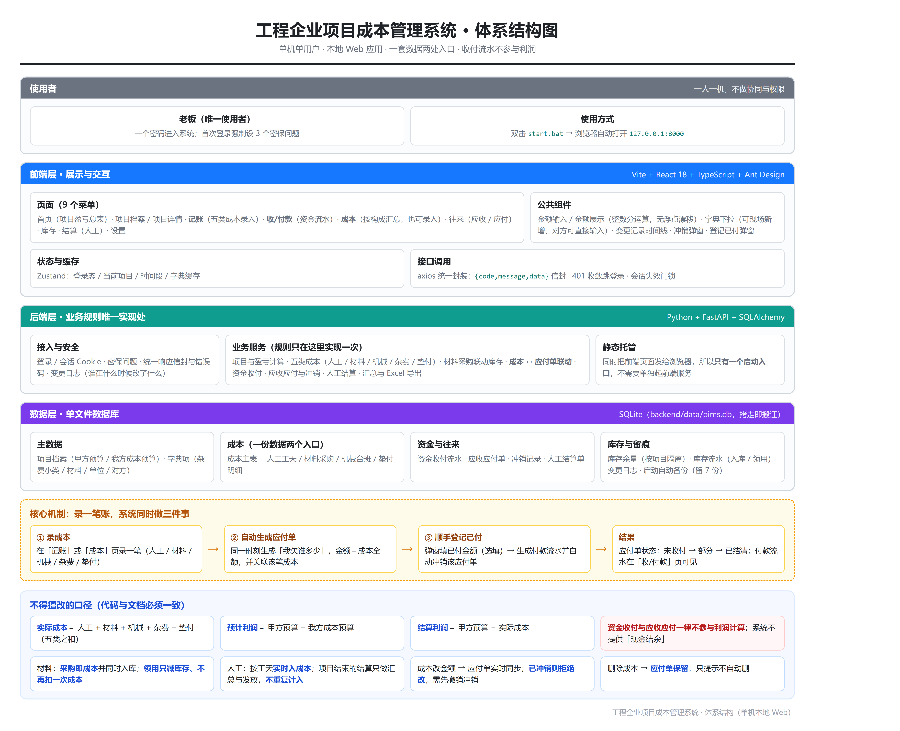
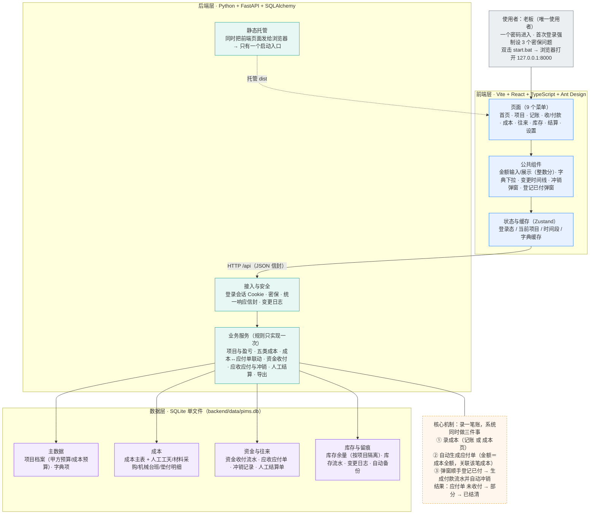

# 06 — 体系结构图

> 图片版：[`assets/体系结构图.png`](assets/体系结构图.png)（5480×4452，2 倍清晰度，可直接插进 Word）
> 可编辑版：[`assets/architecture.html`](assets/architecture.html)（改文字后重新渲染即可）
> 重新渲染：`node scripts/checks/render-html-to-png.mjs docs/assets/architecture.html docs/assets/体系结构图.png`

---

## 图片版

---

## Mermaid 版（可粘进支持 Mermaid 的编辑器）

---

## 文字版（如果上面都渲染不出来，看这段）

| 层次 | 内容 |
|---|---|
| **使用者** | 老板一人；一个密码进入，首次登录强制设 3 个密保问题；双击 `start.bat` 即用 |
| **前端层** | Vite + React + TypeScript + Ant Design。 9 个菜单：首页 / 项目 / 记账 / 收/付款 / 成本 / 往来 / 库存 / 结算 / 设置。 公共组件：金额输入与展示（整数分运算，无浮点漂移）、字典下拉（可现场新增、对方可直接输入）、变更记录时间线、冲销弹窗、登记已付弹窗。 状态：Zustand 存登录态、当前项目、时间段、字典缓存。 接口：axios 统一信封 `{code,message,data}`，401 收敛跳登录。 |
| **后端层** | Python + FastAPI + SQLAlchemy。 接入与安全：登录会话、密保、统一错误码、变更日志。 业务服务（规则只在这里实现一次）：项目与盈亏、五类成本、成本↔应付单联动、资金收付、应收应付与冲销、人工结算、汇总与 Excel 导出。 静态托管：同时把前端页面发给浏览器，**所以只有一个启动入口**。 |
| **数据层** | SQLite 单文件 `backend/data/pims.db`，拷走即搬迁。 主数据：项目档案、字典项。 成本：成本主表 + 四类明细表。 资金与往来：资金收付流水、应收应付单、冲销记录、人工结算单。 库存与留痕：库存余量（按项目隔离）、库存流水、变更日志、启动自动备份（留 7 份）。 |

**核心机制（录一笔账同时做三件事）**

1. 在「记账」或「成本」页录一笔成本（人工 / 材料 / 机械 / 杂费 / 垫付）
2. **同一时刻**自动生成一张应付单：金额＝成本全额，并关联该笔成本
3. 弹出「登记已付」（选填）→ 填了金额就生成付款流水并**自动冲销**该应付单
4. 结果：应付单状态 `未收付 → 部分 → 已结清`；付款流水在「收/付款」页可见

**不得擅改的口径**

| 口径 | 定义 |
|---|---|
| 实际成本 | 人工 + 材料 + 机械 + 杂费 + 垫付（五类之和） |
| 预计利润 | 甲方预算 − 我方成本预算 |
| 结算利润 | 甲方预算 − 实际成本 |
| 铁律 | **资金收付与应收应付一律不参与利润计算**；系统不提供「现金结余」 |
| 材料 | 采购即成本并同时入库；**领用只减库存、不再扣一次成本** |
| 人工 | 按工天实时入成本；项目结束的结算只做汇总与发放，**不重复计入** |
| 改成本金额 | 应付单实时同步；**已冲销则拒绝改**，需先撤销冲销 |
| 删成本 | **应付单保留**，只提示不自动删 |
